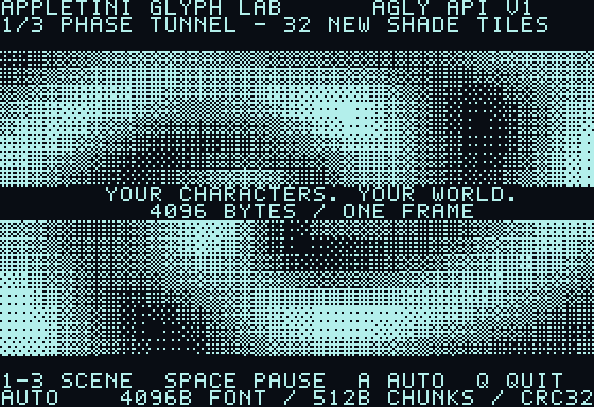
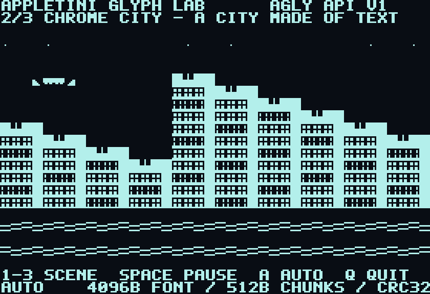
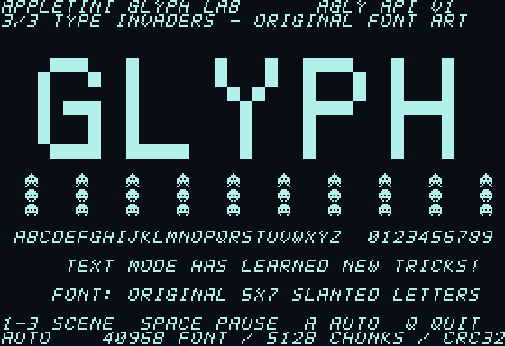

# Glyph Lab

A bootable Apple //e demo of Appletini's AGLY v1 character-ROM API. The
picture uses **40-column text mode**. Each scene uploads a new 4 KiB font
through SmartPort, then moves ordinary text characters to animate it.

1. **Phase Tunnel:** 32 dithered glyphs form moving waves and a shaded tunnel.
2. **Chrome City:** building, window, star and saucer glyphs make a scrolling city.
3. **Type Invaders:** solid tiles spell GLYPH above animated creatures and an
   original slanted font.





## Run

Mount **[Glyph-Lab.hdv](Glyph-Lab.hdv)** as an Appletini SmartPort disk and
boot it. The 800 KiB ProDOS volume starts `GLYPH.SYSTEM` directly. You can
also run that SYS file from a ProDOS launcher.

Use firmware with the AGLY v1 extension and an active ARM video renderer.
The demo checks the slot-7 Appletini ROM before calling it, then checks the
API version, ROM size, chunk size and availability flag. Older firmware,
other cards, a busy upload and an unavailable renderer get a readable
message; a key then returns to ProDOS.

| Key | Action |
| --- | --- |
| `1` / `2` / `3` | Load that scene and stop automatic scene changes |
| `Space` | Pause or resume animation |
| `A` | Resume automatic scene changes |
| `Q` / `Esc` | Restore the menu's character ROM and quit |

The demo starts in automatic mode. It changes scene about every twelve
seconds and draws a new tile frame every four motherboard vblank edges.
Uploads happen only at scene changes, not on every animation frame. A quit
key received during an upload stays queued; the demo finishes applying the
font, restores the configured ROM, then exits.

The new glyphs appear on Appletini's rendered video. The motherboard's
physical character ROM and composite video keep their own glyphs. If a
restore fails, the demo displays the error and directs you to the Video
menu. Reset or a crash can bypass the normal exit path.

PAL Accurate also reads graphics patterns from the raw video ROM. These
original full-ROM images define text glyphs and mirror the first bank;
graphics shown while a demo font is active can therefore change too. The
demo stays in text mode. Its normal exit restores the whole configured
4 KiB ROM, including the graphics bank.

## Build and test

Python 3, ACME, Pillow and py65 are required. The default firmware checkout
is the sibling `appletini-one`; override it with `--appletini-root`.

```sh
python tools/build.py
python tests/test_glyph_lab.py -v
```

The build generates three original 4 KiB fonts, 24 text-tile frames, the
6502 SYS file, previews and the bootable image. `Glyph-Lab.hdv`, `manifest.json`
and `previews/` contain the deliverables. `build/` and `dist/` can be regenerated.
The SYS file loads at `$2000` and stays below ProDOS at `$B000`; it needs no
auxiliary RAM or acceleration mode.

The tests execute the assembled 6502 application **and the current C700/C800
SmartPort ROM**, including its FIFO writes and replies. The modeled ARM
backend checks every control frame, all eight 512-byte writes, complete
coverage and CRC32. Tests cover scene selection, pause/resume, automatic
scene changes, delayed frame application, normal restore, a quit key during
upload, old firmware, bad status/slot signatures, unavailable or busy APIs,
write failures, apply timeout and restore failures. Disk tests compare the
boot blocks, ProDOS kernel, SYS payload and manifest hashes.

These are host tests and model previews. The demo has also been successfully
validated on hardware by the user. The previews decode the same
font bytes and text cells as the demo; they do not reproduce HDMI scaling,
composite colour or phosphor settings.

## API example

The source uses SmartPort `STATUS $00` and `CONTROL $04`, controller unit
`0`, private selector `$81`. `STATUS` returns 32 bytes starting with `AGLY`.
`CONTROL` starts with a little-endian 16-bit payload length, followed by the
16-byte AGLY header:

| Offset | Field |
| --- | --- |
| 0 | `AGLY` |
| 4 | Major version `1` |
| 5 | Operation: BEGIN `1`, WRITE `2`, COMMIT `3`, ABORT `4`, RESTORE `5` |
| 6–7 | Zero flags and reserved byte |
| 8 | Little-endian 32-bit transaction ID |
| 12 | Little-endian 16-bit byte offset |
| 14 | Little-endian 16-bit byte count |

BEGIN gets a nonzero transaction ID. Eight WRITE calls append 512 bytes
each. COMMIT appends an IEEE CRC32 calculated over all 4096 ROM bytes. The
demo waits until STATUS clears `PENDING` (flag `$0004`) and advances the
applied generation at offset 24 before showing the scene. RESTORE uses a
zero transaction ID and waits for the same application boundary. The outer
payload length excludes its own two-byte word.

`tools/assets.py` writes active-low ROM rows. Normal characters `$80–$FF`
use ROM addresses `$400–$7FF`; custom tiles occupy `$80–$9F` and printable
letters use `$A0–$FF`. The generator defines inverse and alternate-set
glyphs and mirrors the used 2 KiB into the second bank for raw PAL ROM
addressing. All letters, tiles and scene art come from the generator; no
Apple character ROM is distributed by this demo.

## Provenance

`manifest.json` records SHA-256 for the source, asset generator, supplied
ProDOS master, extracted ProDOS kernel, SYS file and disk. The boot blocks
and kernel come from `appletini-one/software/ProDOS_2_4_3.po`. The small
ProDOS image reader/writer in `tools/prodos.py` comes from this repository's
`demos/bilestoad/tools/prodos.py`. Tests read the firmware checkout's current
SmartPort ROM files; they do not replace the ROM with a simulated entry point.
